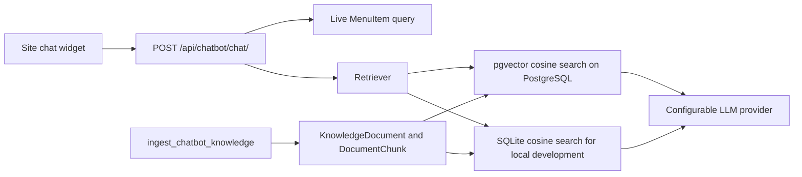
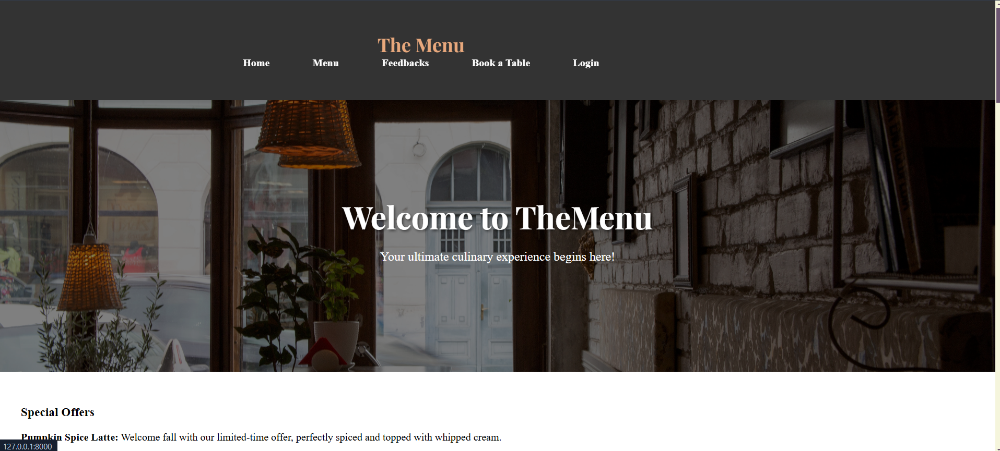
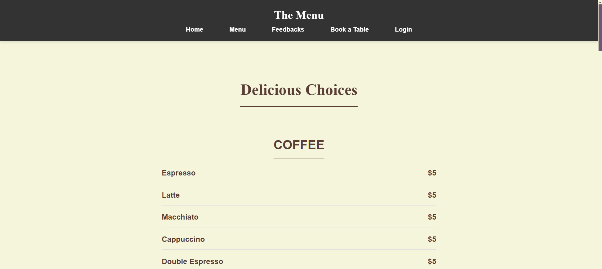
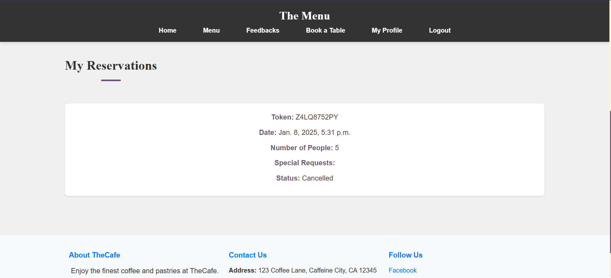
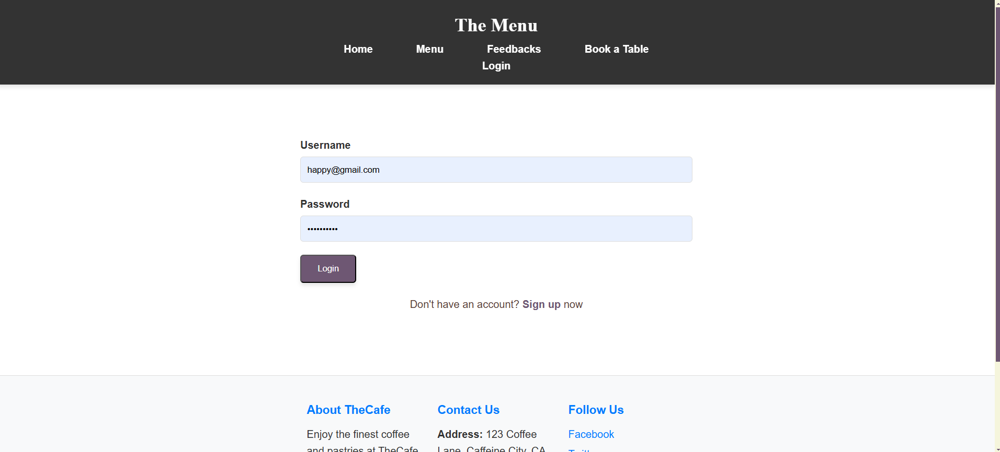

# Café Management Website

## Project Overview
The **Café Management Website** is a web-based platform designed to streamline café operations, enhance customer experience, and provide an intuitive interface for managing orders, reservations, and feedback. The website features a modern UI with a warm and earthy aesthetic, interactive animations, and a user-friendly navigation system.

## Features
- **Home Page**: Welcoming hero section with an image and introductory message.
- **Navigation Bar**: Sticky, well-structured navbar for easy access to different sections.
- **Menu Section**: Displays available café items with text overlays on images.
- **Reservation System**: Allows customers to book tables seamlessly.
- **Customer Feedback**: Section for collecting and displaying customer reviews.
- **Parallax Scrolling**: Enhances the visual appeal of the "About Us" section.
- **Image Hover Effects**: Zoom, grayscale-to-color, overlay, and blur effects.
- **Footer**: Includes social links and contact details.

## Technologies Used
- **Frontend**: HTML, CSS, JavaScript
- **Backend**: Django (Python)
- **Database**: SQLite for local development; PostgreSQL on Render
- **Deployment**: Render Blueprint with Gunicorn and WhiteNoise

## Installation & Setup
1. Clone the repository:
   ```bash
   git clone https://github.com/rakeshp1423/cafe-management.git
   cd cafe-management
   ```
2. Set up a virtual environment:
   ```bash
   python -m venv venv
   source venv/bin/activate  # For Mac/Linux
   venv\Scripts\activate  # For Windows
   ```
3. Install dependencies:
   ```bash
   pip install -r requirements.txt
   ```
4. Set a local-only secret key and enable debug mode for development. Do not reuse
   a production secret locally:
   ```powershell
   $env:DJANGO_SECRET_KEY = "replace-with-a-long-random-secret"
   $env:DEBUG = "true"
   ```
   On macOS/Linux, use `export DJANGO_SECRET_KEY='replace-with-a-long-random-secret'`
   and `export DEBUG=true`.
5. Run migrations:
   ```bash
   python manage.py migrate
   ```
6. Start the development server:
   ```bash
   python manage.py runserver
   ```
7. Open the browser and visit:
   ```
   http://127.0.0.1:8000/
   ```

## Deploy to Render

The repository includes a Render Blueprint (`render.yaml`) that creates a Django
web service and a PostgreSQL database. It runs `collectstatic`, database migrations,
and the idempotent chatbot knowledge seed command during build. WhiteNoise serves
collected static files, the service runs under Gunicorn, and Render checks `/health/`
before routing traffic.

This Blueprint intentionally uses Render's **free** plans for testing:

- The free web service can sleep when idle, so the first request may be delayed.
- The free PostgreSQL database is temporary and expires after Render's trial period.
- The free web service has no persistent disk. Menu and feedback uploads are
  not served in production and any files written to its local filesystem may
  disappear after redeploy/restart; the existing repository database and uploaded
  media are deliberately excluded from Git.
- For real production use, move to a paid PostgreSQL plan with backups and configure
  durable object storage (or a paid persistent disk) for uploads before accepting
  real customer data.

### GitHub and Render setup

1. Review `.gitignore` and the `git status` changes. `db.sqlite3` and `media/` are
   removed from Git tracking to avoid publishing local data and uploads, while
   preserving the local files. This does not erase them from earlier Git commits;
   if the repository was public or contained sensitive data, rotate exposed
   credentials and assess whether Git history must be cleaned before publishing.
2. Push the repository to a GitHub repository you control.
3. In Render, choose **New > Blueprint Instance**, connect the GitHub repository,
   and apply the `render.yaml` Blueprint. Render will provision the free database
   and deploy the web service. Review Render's plan and database-expiration terms
   before confirming.
4. In the Render service environment, set `CHATBOT_API_KEY` to a provider API key.
   Without it, the site can run, but chatbot requests that need model inference
   will report a provider error. Model requests may incur provider charges; set
   provider-side usage limits. For another OpenAI-compatible provider, set its base
   URL and model names using the `CHATBOT_*` variables documented below.
5. Create an administrator from the service's Render Shell:

   ```sh
   python manage.py createsuperuser
   ```

6. The seed command runs during build. After adding or editing menu items and
   knowledge documents in the admin, run this from Render Shell to refresh the
   chatbot index:

   ```sh
   python manage.py ingest_chatbot_knowledge
   ```

For custom domains, set `ALLOWED_HOSTS` to include the domain and add its HTTPS
origin to `CSRF_TRUSTED_ORIGINS` in the Render service environment. Render's
`RENDER_EXTERNAL_HOSTNAME` is automatically included for the generated
`.onrender.com` host.

### Production email

Password-reset email requires a real SMTP provider. Configure `EMAIL_HOST`,
`EMAIL_PORT`, `EMAIL_HOST_USER`, `EMAIL_HOST_PASSWORD`, `EMAIL_USE_TLS`, and
`DEFAULT_FROM_EMAIL` in Render's environment. The SMTP password must be a Render
secret, not a committed file or value in `render.yaml`.

## Contribution Guidelines
1. Fork the repository.
2. Create a new branch for your feature.
3. Commit and push your changes.
4. Submit a pull request.

## Contact
For queries or contributions, reach out to:
- **Developer**: Rakesh Kumar Patra
- **Email**: rrakeshkuma1423@gmail.com
- **GitHub**: [rakeshp1423](https://github.com/rakeshp1423)

---
**© 2025 Café Management Website. All rights reserved.**


## TheMenu AI

TheMenu AI is an optional café information assistant integrated into the existing
Django-template site. It retrieves approved menu/FAQ/policy text, combines it with
live menu rows where exact prices matter, and sends the bounded context to a
configurable Ollama or OpenAI-compatible chat provider. It does not book tables or
check item availability.

### Architecture and data flow



Menu item names and descriptions are indexed; prices are queried from the live
`core.MenuItem` table. The current menu schema has no dietary, allergen, or live
availability fields, so TheMenu AI explicitly declines to guess those values.
Opening hours, contact details, and café policies are not represented as verified
data in the application yet.

The starter knowledge command adds editable guidance about ingredient limitations
and the café story stated on the website. It does not create fictitious dishes,
ingredients, prices, hours, or contact details. Reservation answers explain the
existing sign-in and booking form, its 1-8 guest limit, and that submitting a form
does not check availability or automatically confirm a booking.

### Local setup (Windows PowerShell)

1. Create and activate a virtual environment as described above and install
   dependencies:

   ```powershell
   pip install -r requirements.txt
   ```

2. Set a local Django secret key for the current PowerShell session. Do not use a
   production secret for local development:

   ```powershell
   $env:DJANGO_SECRET_KEY = "replace-with-a-long-random-secret"
   $env:DEBUG = "true"
   ```

   `.env.example` lists all supported variables but is not automatically loaded.
   Configure values in your shell or hosting provider.

3. For local model inference, install [Ollama](https://ollama.com/), then download
   the configured models:

   ```powershell
   ollama pull all-minilm
   ollama pull llama3.2:3b
   ```

   Keep Ollama running on `http://localhost:11434`. The embedding model must
   produce 384-dimensional vectors to match the database schema. Hosted embedding
   providers must also return 384 dimensions; `text-embedding-3-small` is requested
   at 384 dimensions.

4. Apply migrations and start Django:

   ```powershell
   python manage.py migrate
   python manage.py seed_chatbot_knowledge
   python manage.py ingest_chatbot_knowledge --dry-run
   python manage.py ingest_chatbot_knowledge
   python manage.py runserver
   ```

5. Review/edit the starter documents and add verified café FAQs or policy text
   through Django admin under **Knowledge documents**. Use the appropriate source
   type, a stable source identifier, and only information approved for public
   display. To answer dish ingredient questions, add the café's verified ingredient
   information to each menu item's description or an approved FAQ; then re-run
   ingestion. Never add guessed ingredients, allergen claims, hours, or contact data.

6. Index the menu and active knowledge documents:

   ```powershell
   python manage.py ingest_chatbot_knowledge --dry-run
   python manage.py ingest_chatbot_knowledge
   ```

Re-run ingestion after changing menu descriptions or knowledge documents. The
command updates changed chunks, retains unchanged embeddings, and removes indexed
menu sources whose menu rows no longer exist. Price answers always read the current
database rather than the indexed document text.

### PostgreSQL and deployment

SQLite remains supported for local development. Its vectors are stored as JSON
text and ranked with exact cosine distance in Python; this is intended for small
development datasets, not production-scale search.

For PostgreSQL deployments:

1. Use the existing `DATABASE_URL` setting and install the PostgreSQL `vector`
   extension (with HNSW support) on the database server.
2. Run `python manage.py migrate`. The chatbot migration enables `vector` when
   connected to PostgreSQL and creates an HNSW cosine index.
3. Configure `DJANGO_SECRET_KEY` (or the existing Render `SECRET_KEY` variable),
   `DEBUG=false`, `ALLOWED_HOSTS`, and the LLM/embedding provider variables in the
   host environment. Never commit real credentials.
4. The Render configuration already builds the requirements, collects static
   files, and applies migrations. Its database must support the pgvector extension
   before deploying the chatbot migration.

Production settings require HTTPS and secure session/CSRF cookies and emit
one-year HSTS for the application host. HSTS subdomain inclusion and browser
preloading are intentionally not enabled because the repository's Render
subdomain may not control the parent domain or every possible subdomain.

Set both providers to `openai` for an OpenAI-compatible hosted setup. Configure
`CHATBOT_API_KEY`, `CHATBOT_API_BASE_URL`, `CHATBOT_MODEL`,
`CHATBOT_EMBEDDING_MODEL`, and `CHATBOT_EMBEDDING_BASE_URL`; base URLs are the
provider origin without `/v1`. The key is never sent to the browser. Provider
availability, account permissions, billing, and model access must be verified
with the selected provider.

### Environment variables

| Variable | Default | Purpose |
| --- | --- | --- |
| `DJANGO_SECRET_KEY` | required (falls back to existing `SECRET_KEY`) | Django signing key |
| `DEBUG` | `false` | Django debug mode |
| `ALLOWED_HOSTS` | `localhost,127.0.0.1` | Django allowed hosts |
| `DATABASE_URL` | existing local SQLite database | Database connection |
| `CHATBOT_EMBEDDING_PROVIDER` | `ollama` | `ollama` or `openai` |
| `CHATBOT_EMBEDDING_MODEL` | `all-minilm` | Embedding model (384 dimensions required) |
| `CHATBOT_EMBEDDING_BASE_URL` | `http://localhost:11434` | Embedding provider origin |
| `CHATBOT_EMBEDDING_API_KEY` | `CHATBOT_API_KEY` | Optional separate embedding credential |
| `CHATBOT_LLM_PROVIDER` | `ollama` | `ollama` or `openai` |
| `CHATBOT_MODEL` | `llama3.2:3b` | Generation model |
| `CHATBOT_API_BASE_URL` | `http://localhost:11434` | Generation provider origin |
| `CHATBOT_API_KEY` | empty | Hosted provider credential |
| `CHATBOT_TOP_K` | `4` | Maximum retrieved chunks |
| `CHATBOT_MAX_COSINE_DISTANCE` | `0.45` | Maximum cosine distance for a match |
| `CHATBOT_MAX_MESSAGE_LENGTH` | `1000` | Maximum user message length |
| `CHATBOT_MAX_CONTEXT_CHARS` | `12000` | Maximum retrieved/live context sent to the model |
| `CHATBOT_REQUEST_TIMEOUT` | `30` seconds | Provider request timeout |
| `CHATBOT_MAX_OUTPUT_TOKENS` | `400` | Generation limit |
| `CHATBOT_CONVERSATION_RETENTION_DAYS` | `30` | Conversation retention duration |

### API

`POST /api/chatbot/chat/` accepts JSON:

```json
{
  "message": "Which items cost less than ₹200?",
  "conversation_id": null,
  "request_id": "a-client-generated-uuid"
}
```

`request_id` is optional for API clients but should be a fresh UUID per message;
retries with the same ID are idempotent. Success returns:

```json
{
  "answer": "Current menu items matching your price range: …",
  "conversation_id": "server-generated-uuid",
  "sources": [{"title": "Current Menu", "source_type": "menu"}]
}
```

`DELETE /api/chatbot/conversations/<conversation_id>/` deletes only the
authenticated user's or current anonymous session's conversation. Chat history
is server-side, scoped to its owner, bounded to 20 turns/30 days by default, and
purged using `python manage.py purge_chatbot_conversations` (schedule that command
regularly in production). Anonymous sessions are not shared between browsers.
Both endpoints use CSRF protection and a 10 requests/minute throttle; authenticated
users are also limited by the same chatbot scope. The default Django cache is
process-local, so multi-worker deployments should configure a shared cache for
consistent rate limits.

The existing reservation system only accepts a signed-in user's form submission;
it has no availability checks or booking confirmation workflow. The chatbot only
links users to that form and never submits or confirms a reservation.

### Tests and operations

Run chatbot tests and Django checks with:

```powershell
python manage.py test chatbot
python manage.py check
python manage.py makemigrations --check --dry-run
```

Provider calls are mocked in tests. A live provider, PostgreSQL server, pgvector
extension, and production deployment were not exercised by this local test suite.
Hosted inference may incur usage costs and latency. Common failures include a
stopped Ollama service, missing pulled models, an invalid API key, or an embedding
model that does not produce 384 dimensions. Check provider configuration and rerun
the ingestion command after correcting model setup.

## Screenshots

<table>
  <tr>
    <td></td>
    <td> </td>
   
  </tr>
  <tr>
    <td></td>
    <td></td>
  </tr>
  
</table>
